# Review · 2026-11-20T19:57

Contact sheets: 24 random images per set, as the app would get them. Candidates are not in the app yet.

| set | kind | source | images | thumbnails loaded |
|---|---|---|---|---|
| Loomis · Head and Hands | in the app | commons | 111 | 24/24 |
| Bridgman · Constructive Anatomy | in the app | commons | 63 | 24/24, 1 blank |
| Vanderpoel · The Human Figure | in the app | commons | 23 | 23/23 |
| Tavenraat · academy studies | in the app | commons | 44 | 24/24 |
| After casts (Rijksmuseum) | in the app | commons | 58 | 24/24 |
| The Belvedere Torso | in the app | commons | 16 | 16/16 |
| Muybridge · people in motion | in the app | commons | 60 | 24/24 |
| Hands (Rijksmuseum) | in the app | commons | 116 | 24/24 |
| Hands · Italian drawings (Cooper Hewitt) | in the app | commons | 64 | 24/24 |
| Feet (Rijksmuseum) | in the app | commons | 59 | 24/24 |
| Hand studies (Cleveland) | in the app | cma | 15 | 15/15 |
| Heads · Italian drawings (Cooper Hewitt) | in the app | commons | 65 | 24/24 |
| Head studies (AIC) | in the app | aic | 21 | 21/21 |
| Heads (Cleveland) | in the app | cma | 53 | 24/24 |
| Académies (Rijksmuseum) | in the app | commons | 120 | 24/24 |
| Nude studies (AIC) | in the app | aic | 30 | 24/24 |
| Nude studies (Cleveland) | in the app | cma | 58 | 24/24 |

## Loomis · Head and Hands

111 images · `Category:Drawing the Head and Hands`

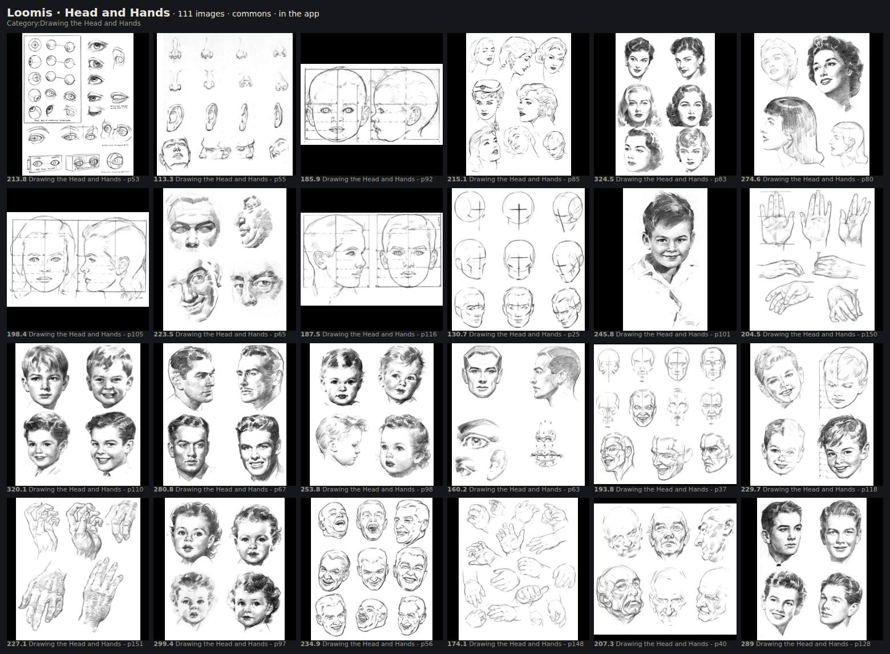

- Drawing the Head and Hands - p53 — William Andrew Loomis, 1956 · Public domain
- Drawing the Head and Hands - p55 — William Andrew Loomis, 1956 · Public domain
- Drawing the Head and Hands - p92 — William Andrew Loomis, 1956 · Public domain
- Drawing the Head and Hands - p85 — William Andrew Loomis, 1956 · Public domain
- Drawing the Head and Hands - p83 — William Andrew Loomis, 1956 · Public domain
- Drawing the Head and Hands - p80 — William Andrew Loomis, 1956 · Public domain
- Drawing the Head and Hands - p105 — William Andrew Loomis, 1956 · Public domain
- Drawing the Head and Hands - p65 — William Andrew Loomis, 1956 · Public domain

## Bridgman · Constructive Anatomy

63 images · `Category:Constructive Anatomy (1920)`

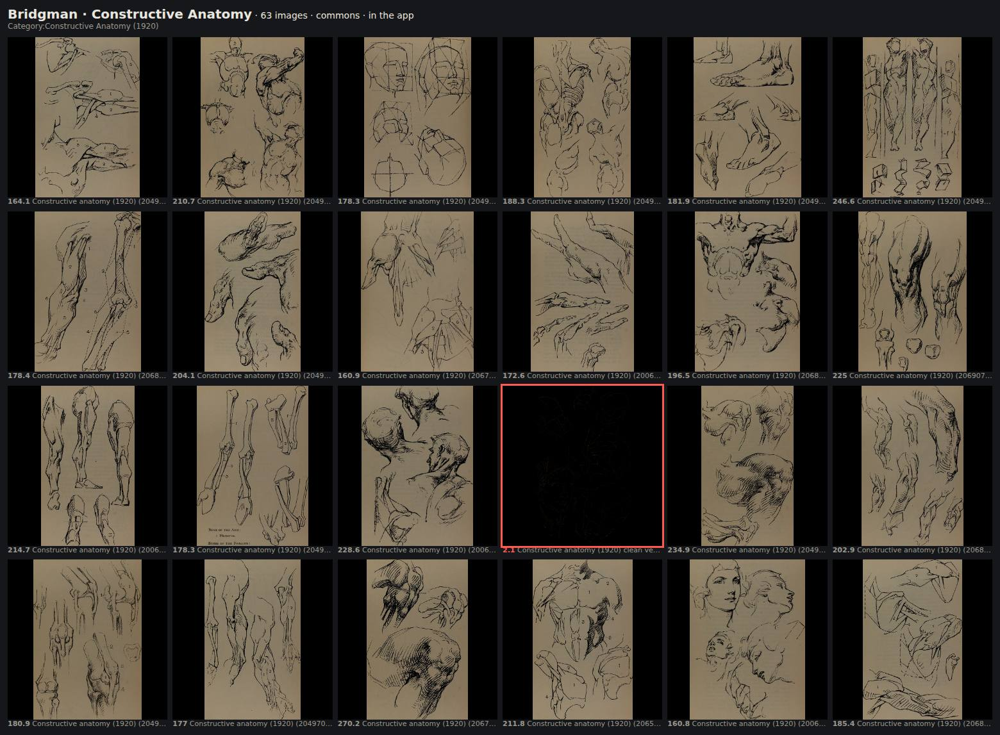

- Constructive anatomy (1920) (20495853790) — Bridgman, George Brant, 1864-1943; Rogers, Bruce, 1870-1957, former owner DLC; …, 1920 · No restrictions
- Constructive anatomy (1920) (20497195509) — Bridgman, George Brant, 1864-1943; Rogers, Bruce, 1870-1957, former owner DLC; …, 1920 · No restrictions
- Constructive anatomy (1920) (20495977118) — Bridgman, George Brant, 1864-1943; Rogers, Bruce, 1870-1957, former owner DLC; …, 1920 · No restrictions
- Constructive anatomy (1920) (20495920138) — Bridgman, George Brant, 1864-1943; Rogers, Bruce, 1870-1957, former owner DLC; …, 1920 · No restrictions
- Constructive anatomy (1920) (20497242859) — Bridgman, George Brant, 1864-1943; Rogers, Bruce, 1870-1957, former owner DLC; …, 1920 · No restrictions
- Constructive anatomy (1920) (20495757180) — Bridgman, George Brant, 1864-1943; Rogers, Bruce, 1870-1957, former owner DLC; …, 1920 · No restrictions
- Constructive anatomy (1920) (20683803515) — Bridgman, George Brant, 1864-1943; Rogers, Bruce, 1870-1957, former owner DLC; …, 1920 · No restrictions
- Constructive anatomy (1920) (20495800630) — Bridgman, George Brant, 1864-1943; Rogers, Bruce, 1870-1957, former owner DLC; …, 1920 · No restrictions

## Vanderpoel · The Human Figure

23 images · `Category:John Vanderpoel`

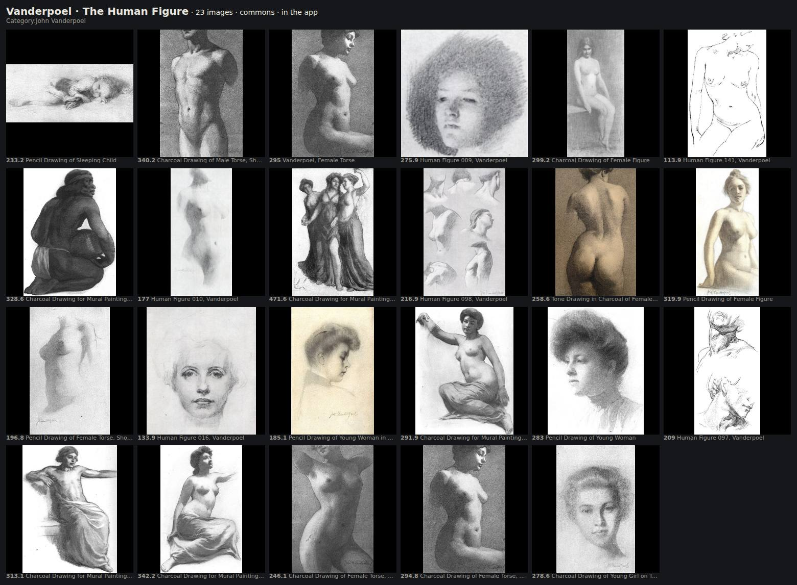

- Pencil Drawing of Sleeping Child — John Vanderpoel · Public domain
- Charcoal Drawing of Male Torse, Showing Wedge Formation — John Vanderpoel · Public domain
- Vanderpoel, Female Torse — John Vanderpoel, 1907 · Public domain
- Human Figure 009, Vanderpoel — John Vanderpoel · Public domain
- Charcoal Drawing of Female Figure — John Vanderpoel · Public domain
- Human Figure 141, Vanderpoel — John Vanderpoel · Public domain
- Charcoal Drawing for Mural Painting, "The Vintage Festival" — John Vanderpoel · Public domain
- Human Figure 010, Vanderpoel — John Vanderpoel · Public domain

## Tavenraat · academy studies

44 images · `Category:Academic studies by Johannes Tavenraat`

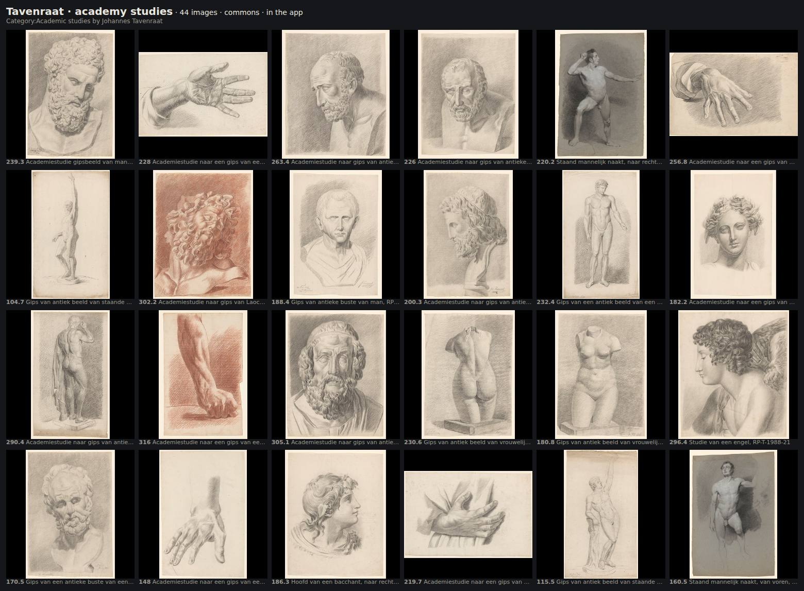

- Academiestudie gipsbeeld van man met baard, RP-T-1988-2 — Rijksmuseum, 1824 · CC0
- Academiestudie naar een gips van een antiek beeld detailstudie van een hand, RP-T-1988-40 — Rijksmuseum, between 1819 and 1881date QS:P,+1850-00… · CC0
- Academiestudie naar gips van antieke buste van een man, RP-T-1988-25 — Rijksmuseum, between 1819 and 1881date QS:P,+1850-00… · CC0
- Academiestudie naar gips van antieke buste van een man, RP-T-1988-26 — Rijksmuseum, between 1819 and 1881date QS:P,+1850-00… · CC0
- Staand mannelijk naakt, naar rechts, RP-T-1988-78 — Rijksmuseum, between 1819 and 1881date QS:P,+1850-00… · CC0
- Academiestudie naar een gips van een antiek beeld detailstudie van een hand, RP-T-1988-41 — Rijksmuseum, between 1819 and 1881date QS:P,+1850-00… · CC0
- Gips van antiek beeld van staande naakt man, met opgeheven linkerarm, RP-T-1988-11 — Rijksmuseum, 1827-11-08 · CC0
- Academiestudie naar gips van Laocoön studie van het hoofd, RP-T-1988-36 — Rijksmuseum, between 1819 and 1881date QS:P,+1850-00… · CC0

## After casts (Rijksmuseum)

58 images · `Category:Drawings of sculptures in the Rijksmuseum Amsterdam`

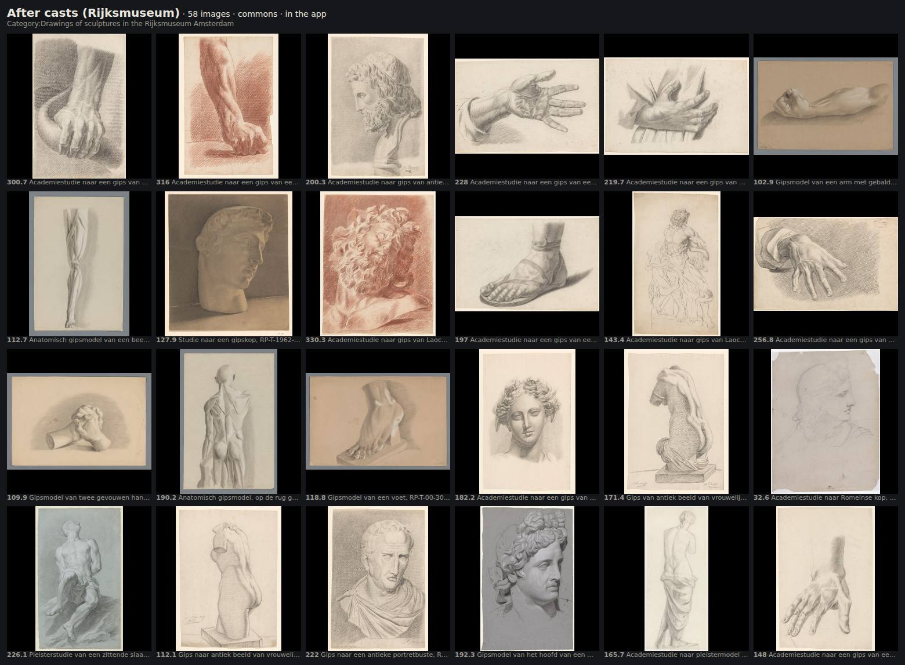

- Academiestudie naar een gips van een antiek beeld detailstudie van een hand uit de Laocoön, RP-T-1988-44 — Rijksmuseum, between 1819 and 1881date QS:P,+1850-00… · CC0
- Academiestudie naar een gips van een antiek beeld detailstudie van een arm met vuist, RP-T-1988-46 — Rijksmuseum, between 1819 and 1881date QS:P,+1850-00… · CC0
- Academiestudie naar gips van antieke buste van een man met baard, RP-T-1988-23 — Rijksmuseum, between 1819 and 1881date QS:P,+1850-00… · CC0
- Academiestudie naar een gips van een antiek beeld detailstudie van een hand, RP-T-1988-40 — Rijksmuseum, between 1819 and 1881date QS:P,+1850-00… · CC0
- Academiestudie naar een gips van een antiek beeld detailstudie van een hand, RP-T-1988-39 — Rijksmuseum, between 1819 and 1881date QS:P,+1850-00… · CC0
- Gipsmodel van een arm met gebalde vuist, RP-T-00-3065 — Rijksmuseum, ca. 1800 - ca. 1900 · CC0
- Anatomisch gipsmodel van een been, RP-T-00-3064 — Rijksmuseum, ca. 1800 - ca. 1900 · CC0
- Studie naar een gipskop, RP-T-1962-292 — Rijksmuseum, between 1874 and 1925date QS:P,+1500-00… · CC0

## The Belvedere Torso

16 images · `Category:Drawings of Belvedere Torso`

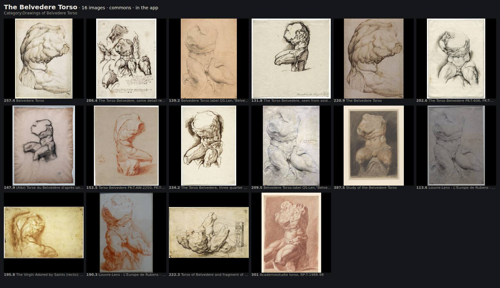

- Belvedere Torso — Maarten van Heemskerck, between circa 1532 and circa 1536date Q… · Public domain
- The Torso Belvedere, some detail repeated, measurements and a sketch of its reconstruction PK-T-609, PK-T-607 — Humbert de Superville, David (1770-1849), Unknown date · CC BY 4.0
- Belvedere Torso.label QS:Len,"Belvedere Torso."label QS:Lnl,"De Torso Belvedere." — Peter Paul Rubens, between 1600 and 1608date QS:P571,+1600… · Public domain
- The Torso Belvedere, seen from aside PK-T-607, PK-T-AW-2250 — Humbert de Superville, David (1770-1849), Unknown date · CC BY 4.0
- The Belvedere Torso — Maarten van Heemskerck, between 1532 and 1537date QS:P571,+1532… · Public domain
- The Torso Belvedere PK-T-606, PK-T-AW-4986 — Humbert de Superville, David (1770-1849), Unknown date · CC BY 4.0
- (Albi) Torse du Belvédère d'après un plâtre Henri de Toulouse-Lautrec - Musée Toulouse-Lautrec — Didier Descouens, Taken on 15 August 2022 · Public domain
- Torso Belvedere PK-T-AW-2250, PK-T-606 — Camper, Petrus (1722-1789), Unknown date · CC BY 4.0

## Muybridge · people in motion

60 images · `Category:Motion studies by Eadweard Muybridge`

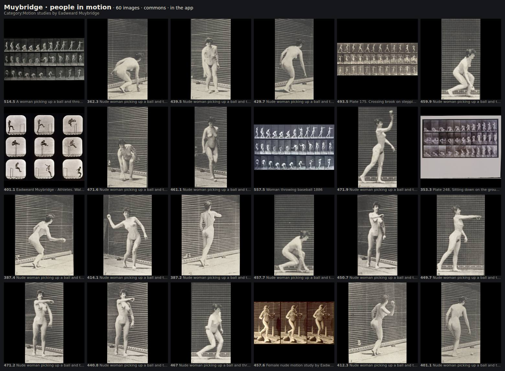

- A woman picking up a ball and throwing. Photogravure after E · CC BY 4.0
- Nude woman picking up a ball and throwing it (rbm-QP301M8-1887-303c~5) — Muybridge, Eadweard, 1830-1904, 1884/1886 · Public domain
- Nude woman picking up a ball and throwing it (rbm-QP301M8-1887-303b~3) — Muybridge, Eadweard, 1830-1904, 1884/1886 · Public domain
- Nude woman picking up a ball and throwing it (rbm-QP301M8-1887-303c~3) — Muybridge, Eadweard, 1830-1904, 1884/1886 · Public domain
- Plate 175. Crossing brook on stepping-stones with a fishing pole and can — Eadweard Muybridge, 1887date QS:P571,+1887-00-00T00:00:00Z/9 · CC0
- Nude woman picking up a ball and throwing it (rbm-QP301M8-1887-303a~6) — Muybridge, Eadweard, 1830-1904, 1884/1886 · Public domain
- Eadweard Muybridge - Athletes. Walking High Leap — Eadweard Muybridge (1830–1904), Taken at Palo Alto, California, in 1879… · Public domain
- Nude woman picking up a ball and throwing it (rbm-QP301M8-1887-303b~5) — Muybridge, Eadweard, 1830-1904, 1884/1886 · Public domain

## Hands (Rijksmuseum)

116 images · `Category:Drawings of hands in the Rijksmuseum Amsterdam`

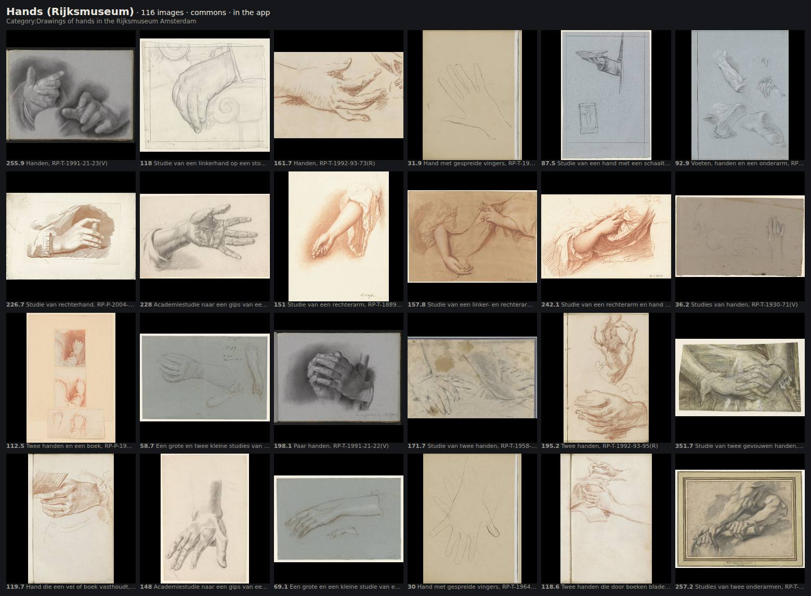

- Handen, RP-T-1991-21-23(V) — Rijksmuseum, ca. mar-1840 · CC0
- Studie van een linkerhand op een stoelleuning, RP-T-1962-252 — Rijksmuseum, between 1874 and 1925date QS:P,+1500-00… · CC0
- Handen, RP-T-1992-93-73(R) — Rijksmuseum, between 1710 and 1772date QS:P,+1750-00… · CC0
- Hand met gespreide vingers, RP-T-1964-223-42 — Rijksmuseum, between 1874 and 1923date QS:P,+1500-00… · CC0
- Studie van een hand met een schaaltje, RP-T-1962-261 — Rijksmuseum, between 1874 and 1925date QS:P,+1500-00… · CC0
- Voeten, handen en een onderarm, RP-T-1953-359A-127 — Rijksmuseum, circa 1751date QS:P,+1751-00-00T00:00:0… · CC0
- Studie van rechterhand, RP-P-2004-358 — Rijksmuseum, between 1732 and 1776date QS:P,+1750-00… · CC0
- Academiestudie naar een gips van een antiek beeld detailstudie van een hand, RP-T-1988-40 — Rijksmuseum, between 1819 and 1881date QS:P,+1850-00… · CC0

## Hands · Italian drawings (Cooper Hewitt)

64 images · `Category:Drawings from Italy in the Cooper–Hewitt, Smithsonian Design Museum - Hands`

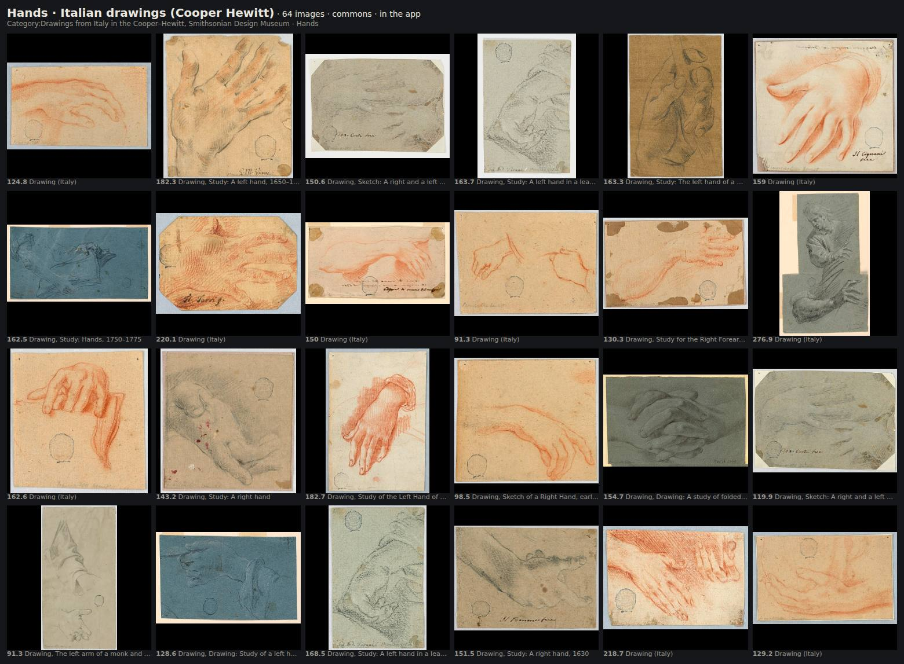

- Drawing (Italy) — Unknown artistUnknown artist, before 1901date QS:P571,+1901-00-00T00:… · Public domain
- Drawing, Study: A left hand, 1650–1700 — Unknown artistUnknown artist, 1650–1700 · Public domain
- Drawing, Sketch: A right and a left hand, 1700–1750 — Unknown artistUnknown artist, 1700–1750 · Public domain
- Drawing, Study: A left hand in a leaning position, ca. 1650 — Giovanni Andrea Sirani, circa 1650date QS:P571,+1650-00-00T00:0… · Public domain
- Drawing, Study: The left hand of a man with a stick, 17th century — Unknown artistUnknown artist, 17th centurydate QS:P571,+1650-00-00T00… · Public domain
- Drawing (Italy) — Unknown artistUnknown artist, before 1901date QS:P571,+1901-00-00T00:… · Public domain
- Drawing, Study: Hands, 1750–1775 — Unknown artistUnknown artist, 1750–1775 · Public domain
- Drawing (Italy) — Unknown artistUnknown artist, before 1901date QS:P571,+1901-00-00T00:… · Public domain

## Feet (Rijksmuseum)

59 images · `Category:Drawings of feet in the Rijksmuseum Amsterdam`

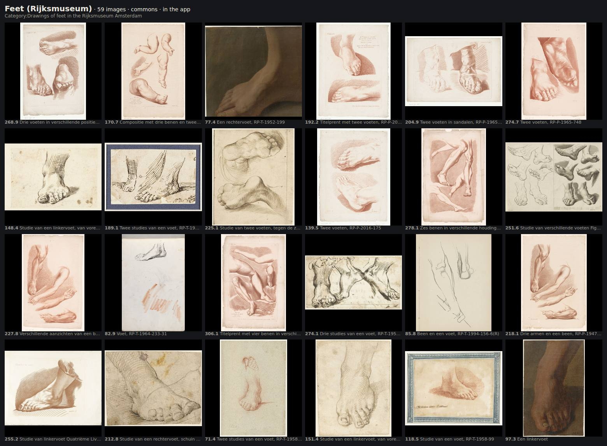

- Drie voeten in verschillende posities, RP-P-1965-712 — Rijksmuseum, 1773 · CC0
- Compositie met drie benen en twee armen, RP-P-1947-97 — Rijksmuseum, circa 1780date QS:P,+1780-00-00T00:00:0… · CC0
- Een rechtervoet, RP-T-1952-199 — Rijksmuseum, between 1770 and 1825date QS:P,+1500-00… · CC0
- Titelprent met twee voeten, RP-P-2016-174 — Rijksmuseum, 1773 · CC0
- Twee voeten in sandalen, RP-P-1965-710 — Rijksmuseum, 1773 · CC0
- Twee voeten, RP-P-1965-748 — Rijksmuseum, between 1784 and 1796date QS:P,+1750-00… · CC0
- Studie van een linkervoet, van voren gezien, RP-T-1958-56 — Rijksmuseum, between 1567 and 1602date QS:P,+1500-00… · CC0
- Twee studies van een voet, RP-T-1958-70 — Rijksmuseum, between 1585 and 1642date QS:P,+1500-00… · CC0

## Hand studies (Cleveland)

15 images · `hands`

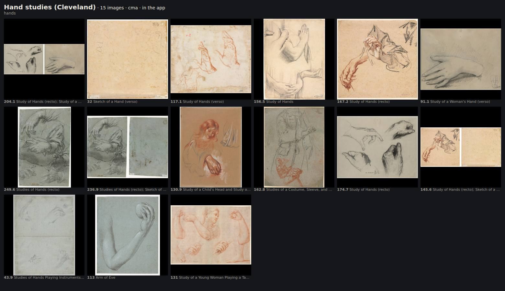

- Study of Hands (recto); Study of a Woman's Hand (verso) — Théodule Ribot, 1800s · CC0
- Sketch of a Hand (verso) — Pierre Lenfant, 1700s · CC0
- Study of Hands (verso) — Camillo Procaccini, c. 1590 · CC0
- Study of Hands — Jean-Auguste-Dominique Ingres, 1842 · CC0
- Study of Hands (recto) — Pierre Lenfant, 1700s · CC0
- Study of a Woman's Hand (verso) — Théodule Ribot, 1800s · CC0
- Studies of Hands (recto) — Carletto Caliari, c. 1586 · CC0
- Studies of Hands (recto); Sketch of a Child's Head (verso) — Carletto Caliari, c. 1586 · CC0

## Heads · Italian drawings (Cooper Hewitt)

65 images · `Category:Drawings from Italy in the Cooper–Hewitt, Smithsonian Design Museum - Human head`

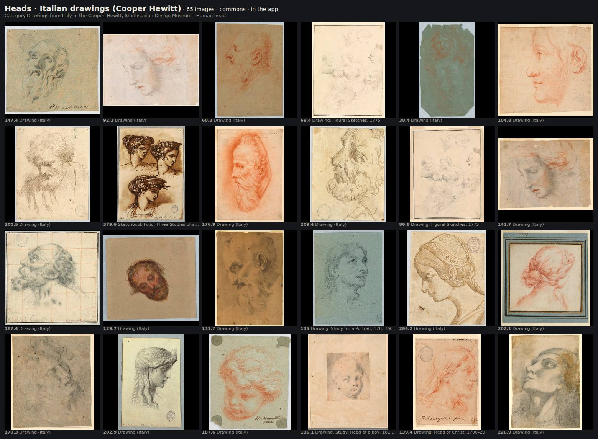

- Drawing (Italy) — Unknown artistUnknown artist, before 1901date QS:P571,+1901-00-00T00:… · Public domain
- Drawing (Italy) — Unknown artistUnknown artist, before 1901date QS:P571,+1901-00-00T00:… · Public domain
- Drawing (Italy) — Unknown artistUnknown artist, before 1901date QS:P571,+1901-00-00T00:… · Public domain
- Drawing, Figural Sketches, 1775 — Carlo Marchionni, 1775date QS:P571,+1775-00-00T00:00:00Z/9 · Public domain
- Drawing (Italy) — Unknown artistUnknown artist, before 1901date QS:P571,+1901-00-00T00:… · Public domain
- Drawing (Italy) — Unknown artistUnknown artist, before 1901date QS:P571,+1901-00-00T00:… · Public domain
- Drawing (Italy) — Unknown artistUnknown artist, before 1901date QS:P571,+1901-00-00T00:… · Public domain
- Sketchbook Folio, Three Studies of a Head with Diadem and Braided Hair, after Raphael, 1810–20 — Unknown artistUnknown artist, 1810–20 · Public domain

## Head studies (AIC)

21 images · `head study`

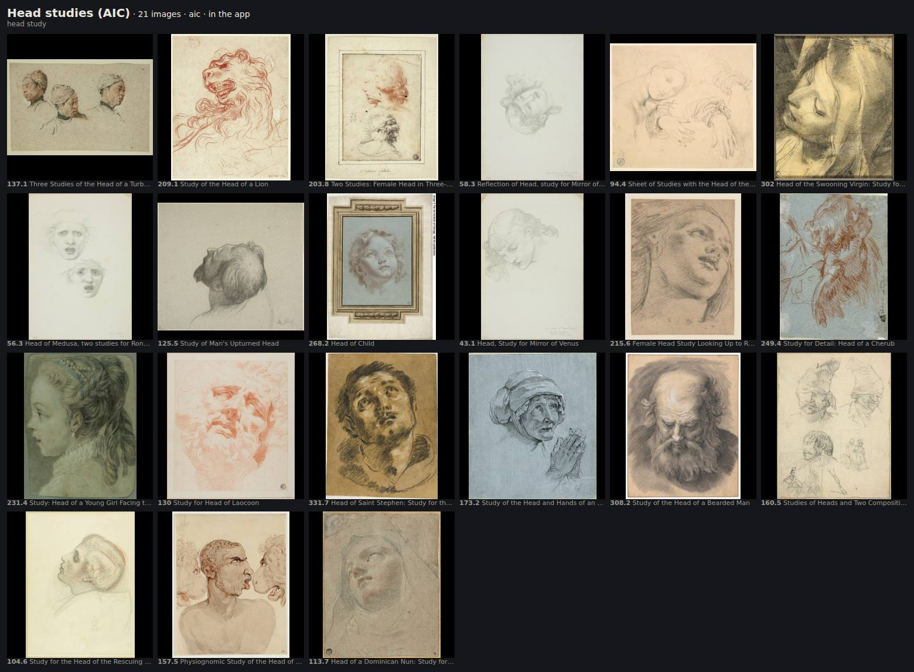

- Three Studies of the Head of a Turbaned Black Man — Nicolas Lancret, 1720/30 · Public domain
- Study of the Head of a Lion — Baldassare Franceschini, n.d. · Public domain
- Two Studies: Female Head in Three-Quarter Profile; Female Bust Seen from the Back — Stefano della Bella, c. 1647 · Public domain
- Reflection of Head, study for Mirror of Venus — Sir Edward Burne-Jones, c. 1873–77 · Public domain
- Sheet of Studies with the Head of the Fornarina and Hands of Madame de Senonnes — Jean Auguste Dominique Ingres, 1814/16 · Public domain
- Head of the Swooning Virgin: Study for the Deposition (recot) Base of Column (verso) — Federico Barocci, 1568/69 · Public domain
- Head of Medusa, two studies for Rondanini Medusa — Sir Edward Burne-Jones, c. 1873–77 · Public domain
- Study of Man's Upturned Head — Alexandre Cabanel, c. 1878 · Public domain

## Heads (Cleveland)

53 images · `head of`

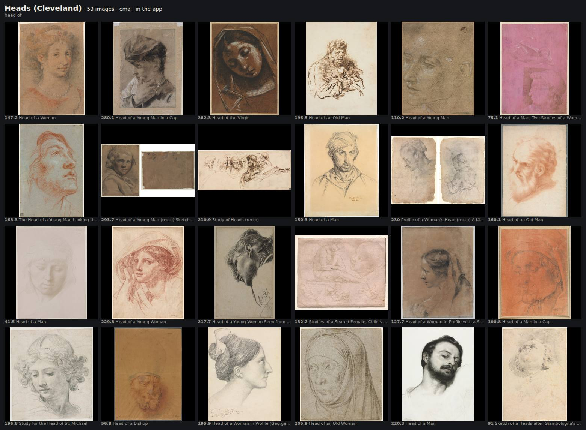

- Head of a Woman — Anonymous, 1600s · CC0
- Head of a Young Man in a Cap — Giovanni Battista Piazzetta, first half 18th century · CC0
- Head of the Virgin — Giacomo Cavedone, c. 1614 · CC0
- Head of an Old Man — Paul Gavarni, 1858 · CC0
- Head of a Young Man — Filippino Lippi, second half 1400s · CC0
- Head of a Man, Two Studies of a Woman's Profile, and a Study of An Angel (verso) — Benozzo Gozzoli, c. 1458 · CC0
- The Head of a Young Man Looking Upwards to the Right — Giovanni Battista Tiepolo, before 1752 · CC0
- Head of a Young Man (recto) Sketch of a Head (verso) — Gaetano Gandolfi, 1780s · CC0

## Académies (Rijksmuseum)

120 images · `Category:Nude drawings in the Rijksmuseum Amsterdam`

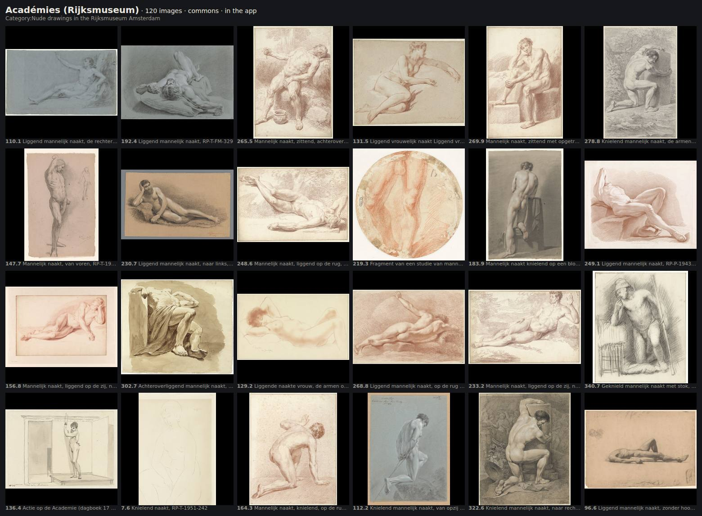

- Liggend mannelijk naakt, de rechterarm opgeheven, RP-T-00-2027 — Rijksmuseum, between 1700 and 1800date QS:P,+1500-00… · CC0
- Liggend mannelijk naakt, RP-T-FM-329 — Rijksmuseum, between 1771 and 1858date QS:P,+1500-00… · CC0
- Mannelijk naakt, zittend, achterovergeleund, RP-T-00-1332 — Rijksmuseum, 1736 · CC0
- Liggend vrouwelijk naakt Liggend vrouwelijk naakt, naar rechts, RP-T-1950-87 — Rijksmuseum, ca. 1750 - ca. 1760 · CC0
- Mannelijk naakt, zittend met opgetrokken knieën, RP-T-00-1331 — Rijksmuseum, 1729 · CC0
- Knielend mannelijk naakt, de armen om een blok geslagen, RP-T-FM-194 — Rijksmuseum, between 1751 and 1822date QS:P,+1500-00… · CC0
- Mannelijk naakt, van voren, RP-T-1950-195(R) — Rijksmuseum, between 1848 and 1927date QS:P,+1500-00… · CC0
- Liggend mannelijk naakt, naar links, RP-T-00-3061 — Rijksmuseum, 1839 · CC0

## Nude studies (AIC)

30 images · `nude study`

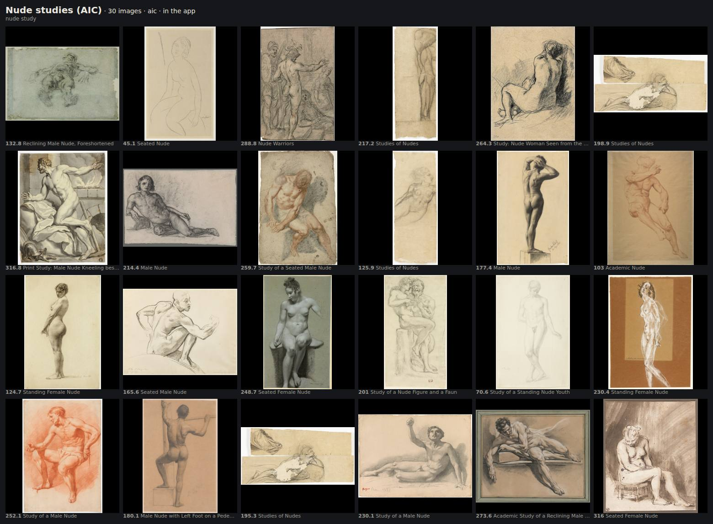

- Reclining Male Nude, Foreshortened — Tintoretto, 1562 · Public domain
- Seated Nude — Amedeo Modigliani, 1918 · Public domain
- Nude Warriors — Circle of Federico Zuccaro, n.d. · Public domain
- Studies of Nudes — Henry Fuseli, n.d. · Public domain
- Study: Nude Woman Seen from the Back (recto) Sketches of Peasants Working (verso) — Jean François Millet, c. 1846 · Public domain
- Studies of Nudes — Henry Fuseli, n.d. · Public domain
- Print Study: Male Nude Kneeling beside a Furnace (Vulcan) — Louis Chéron, c. 1680-1720 · Public domain
- Male Nude — Paul Cezanne, 1863/66 · Public domain

## Nude studies (Cleveland)

58 images · `nude`

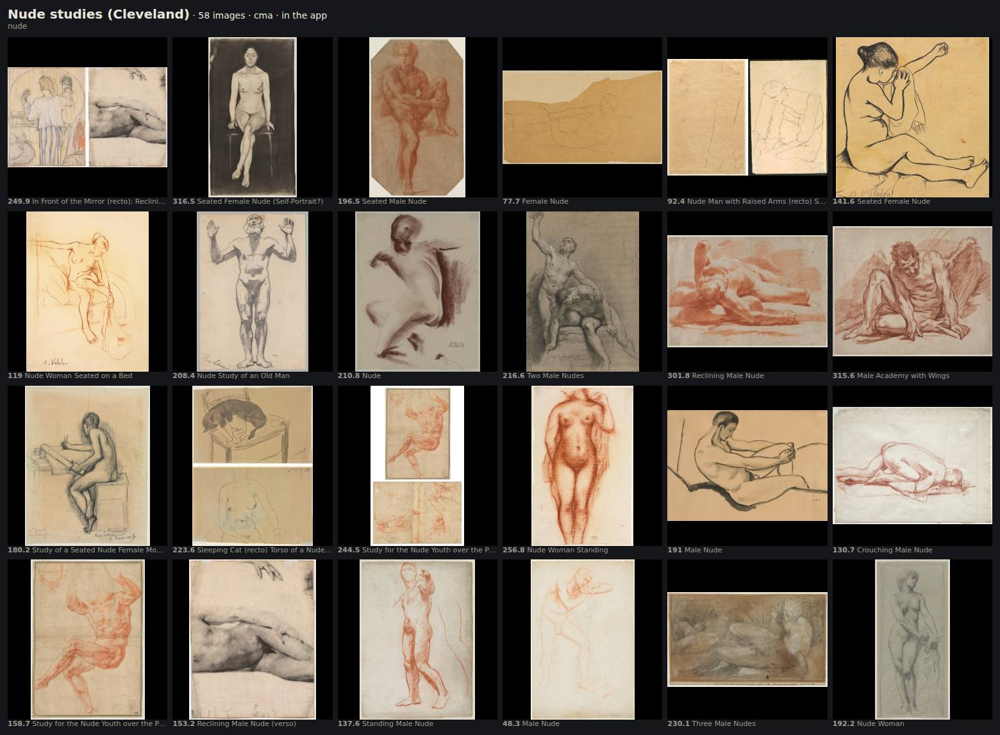

- In Front of the Mirror (recto); Reclining Male Nude (verso) — Édouard Vuillard, c. 1891–92 (recto); c. 1887–89 (verso) · CC0
- Seated Female Nude (Self-Portrait?) — Paula Modersohn-Becker, c. 1899 · CC0
- Seated Male Nude — Baccio Bandinelli, c. 1516–20 · CC0
- Female Nude — Pierre Puvis de Chavannes, 1891 · CC0
- Nude Man with Raised Arms (recto) Seated Man (verso) — Egon Schiele, 1911 · CC0
- Seated Female Nude — Suzanne Valadon, first third 1900s · CC0
- Nude Woman Seated on a Bed — Suzanne Valadon, first third 20th century · CC0
- Nude Study of an Old Man — Henri Lehmann, before 1852 · CC0
